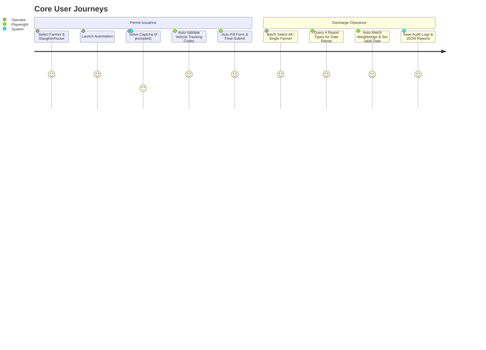
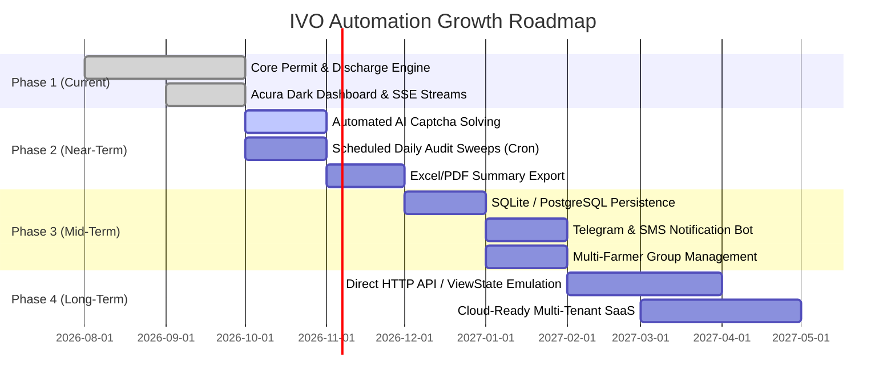

# 📋 Product Requirements Document (PRD)
## IVO Automation Platform (سامانه جامع اتوماسیون خدمات دامپزشکی)

---

| **Document Version** | `1.0.0-DRAFT` |
| **Status** | Active / Living Document |
| **Last Updated** | 2026-10-03 |
| **Project Lead** | Paliz / Engineering & Product |
| **Repository** | `ivo-automation` |
| **Target Portal** | Iranian Veterinary Organization (IVO) – `https://e.ivo.ir` |

---

## 1. Executive Summary & Vision

### 1.1 Vision Statement
The **IVO Automation Platform** is a specialized robotic process automation (RPA) and monitoring suite designed to eliminate manual data entry, streamline compliance workflows, and provide end-to-end visibility for poultry farmers, transport contractors, and veterinary operators interacting with the **e.ivo.ir** national portal.

### 1.2 The Core Value Proposition
- **Time Savings:** Reduces a 15–20 minute multi-step manual permit issuance and tracking check to under 60 seconds per flock.
- **Human-Error Reduction:** Eliminates typos in 10-12 digit codes (epidemiologic codes, hatching permit IDs, slaughterhouse Jihad codes, vehicle tracking numbers).
- **Batch Processing:** Allows batch audit and automatic discharge clearance (`تایید تخلیه`) across dozens of farm accounts in a single scheduled run.
- **Auditability:** Preserves timestamped JSON snapshots of all operations, tracking codes, and weighbridge confirmations.

---

## 2. Problem Statement & Opportunities

### 2.1 The Current Operational Friction
The legacy national veterinary portal (`e.ivo.ir`) is built on legacy ASP.NET WebForms (`.aspx`) with heavy ViewState, strict session timeouts, modal alert dialogues, and mandatory image captchas. Users face severe bottlenecks:
1. **Permit Issuance Drag:**
   - Requiring multiple nested navigation steps (`درون استانی > برون شهرستانی > طیور`).
   - Trial-and-error matching of vehicle tracking codes (`کدهای رهگیری خودرو`) against the quota.
   - Re-entering static farm data (breed, farm owner, destination slaughterhouse Jihad ID, flock age, piece count) every single trip.
2. **Discharge Confirmation Backlog (`تایید تخلیه گواهی‌ها`):**
   - Slaughterhouses require farmers to record discharge confirmation for every single delivery.
   - Finding un-discharged shipments requires traversing 4 separate reporting views (`خروجی وارداتی`, `خروجی داخلی`, `خروجی صادراتی`, `درون استانی`).
   - For each missing record, the operator must compute the Persian date (+1 day from dispatch), query the tracking ID, trigger the weighbridge sync (`دریافت مستقیم اطلاعات از باسکول`), and submit.
   - Performing this manually for 10–50 farmers daily causes severe administrative backlog.
3. **Session Fragility:**
   - Unstable network conditions or idling causes session logouts, losing partially filled multi-page forms.

---

## 3. User Personas & Core Journeys



### 3.1 Personas
1. **Poultry Farm Operator / Expeditor (کاربر دامدار / مرغدار):**
   - Needs permits issued swiftly on shipment days without technical complexity.
2. **Operations & Compliance Manager (مدیر بازرگانی و ترابری):**
   - Manages multiple farms simultaneously; needs quick batch sweeps to ensure all past deliveries are marked "discharged" (`تخلیه شده`) to prevent legal/regulatory transport freezes.
3. **System Automation Admin:**
   - Monitors script runs, configures vehicle tracking lists, and maintains account credentials.

---

## 4. Current System Architecture (v1.0 Baseline)

```
┌─────────────────────────────────────────────────────────────┐
│                      Client Browser                         │
│   Acura Minimal UI (RTL, Dark Canvas, Real-Time Stepper)    │
└──────────────┬──────────────────────────────▲───────────────┘
               │ HTTP / JSON API              │ Server-Sent Events (SSE)
               ▼                              │
┌─────────────────────────────────────────────┴───────────────┐
│                    Express.js Server                        │
│                     (Port 3000)                             │
├──────────────────────────────┬──────────────────────────────┤
│    Permit Service Engine     │   Discharge Service Engine   │
│  (permit_service.js)         │  (discharge_service.js)      │
├──────────────────────────────┴──────────────────────────────┤
│               Playwright Chromium Controller                │
│    (Headless / Headed, Session & Navigation Management)     │
└──────────────┬──────────────────────────────┬───────────────┘
               ▼                              ▼
┌──────────────────────────────┐┌─────────────────────────────┐
│        Local Data Store      ││         Target Portal       │
│  - users.json                ││      https://e.ivo.ir       │
│  - slaughterhouses.json      ││    (ASP.NET WebForms,       │
│  - tracking_codes.json       ││     Session & Captchas)     │
│  - results/*.json (Reports)  ││                             │
└──────────────────────────────┘└─────────────────────────────┘
```

### 4.1 Tech Stack & Codebase Modularization
- **Backend Core:** Node.js (v18+) and Express.js, structured into feature-driven modules under [`src/`](file:///Users/paliz/Desktop/Development/ivo-automation/src):
  - `src/features/permit/`: Transport permit issuance engine (`permit.service.js`) and tracking code repository (`permit.repository.js`).
  - `src/features/discharge/`: Clearance verification engine (`discharge.service.js`).
  - `src/features/users/`: Account repository and slaughterhouse destination directory.
  - `src/features/reports/`: Historical JSON report reader and stats aggregator.
  - `src/api/`: Modular controllers, SSE broker, and central route definitions.
  - `src/core/`: Shared computational engines (Jalali calendar math, leap year calculators).
  - `src/config/`: Single-source-of-truth path resolvers and IVO endpoint constants.
  - `src/cli/`: Interactive terminal runner.
- **Frontend / UI:** Native HTML5, CSS3, JavaScript (no framework overhead) located in [`public/`](file:///Users/paliz/Desktop/Development/ivo-automation/public) (`css/style.css`, `js/app.js`), following the **Acura Design System** (`acura.design.md`):
  - Canvas: `#0d0d0d` near-black surface.
  - Accent / Voltage: `#cc0000` (Acura Performance Red).
  - Typography: `Vazirmatn` for Persian clarity, `Rajdhani` and `Inter` for metrics and numbers.
- **Data Persistence:** Dedicated [`data/`](file:///Users/paliz/Desktop/Development/ivo-automation/data) directory (`users.json`, `slaughterhouses.json`, `tracking_codes.json`, `last_successful_code.json`) with root symlinks for backward compatibility.
- **Storage:** Local flat JSON storage with timestamped audit trail in [`results/`](file:///Users/paliz/Desktop/Development/ivo-automation/results).
- **OCR:** Integrated `tesseract.js` + `sharp` experimental pipeline + Human-in-the-loop UI modal.

---

## 5. Functional Requirements & Feature Breakdown

### Module 1: Automated Transport Permit Issuance (`صدور پروانه حمل`)
| ID | Requirement | Description | Status |
|:---|:---|:---|:---|
| **PERM-01** | User Profile Preloading | Select farmer from `users.json` with auto-population of National Code, Hatching Permit Code, Epidemiologic Code, and default breed. | ✅ Implemented |
| **PERM-02** | Destination Slaughterhouse Selection | Dropdown populated from `slaughterhouses.json` with destination Jihad agricultural IDs. | ✅ Implemented |
| **PERM-03** | Batch Vehicle Tracking Code Evaluation | Iterates through `tracking_codes.json` (or custom user-input list). Clicks "حمل به کشتارگاه" upon first valid hit. | ✅ Implemented |
| **PERM-04** | Form Auto-Fill (Stage 1) | Sets commodity type (`گوشت مرغ`), flock age (`45 روز`), breed, hatching permit code, and fetches slaughterhouse unit data (`فراخوانی واحد`). | ✅ Implemented |
| **PERM-05** | Final Approval Page (`a2_4_2_tyr_mog_cp.aspx`) | Enters farmer name, sets gender (`هر دو`), purpose (`(کشتار)`), validity (`3 روز`), standard notes with epidemiologic & tracking IDs, and submits. | ✅ Implemented |
| **PERM-06** | Real-Time UI Stepper | Visual 5-step progress indicator tracking authentication, tracking search, payload filling, and final confirmation. | ✅ Implemented |
| **PERM-07** | Last Successful Code Memory | Automatically saves the successful tracking code to `last_successful_code.json` and updates the active list. | ✅ Implemented |

---

### Module 2: Clearance & Discharge Verification (`استعلام و تایید تخلیه گواهی‌ها`)
| ID | Requirement | Description | Status |
|:---|:---|:---|:---|
| **DISC-01** | Batch & Single User Execution | Option to process all registered farmers (`ALL`) sequentially or test a single selected user. | ✅ Implemented |
| **DISC-02** | Dynamic Jalali Date Calculation | Computes start date 1 month prior (e.g. 1st of previous Jalali month) accounting for leap years. | ✅ Implemented |
| **DISC-03** | Multi-Report Scraping | Sequentially queries: 1. `Rep_RCV_KV.aspx` (وارداتی), 2. `Rep_RCV_KD.aspx` (داخلی), 3. `Rep_RCV_KS.aspx` (صادراتی), 4. `Rep_RCV_KO.aspx` (درون استانی). | ✅ Implemented |
| **DISC-04** | Status Classification | Distinguishes between discharged items and un-discharged / no-arrival records (`عدم وصول`). | ✅ Implemented |
| **DISC-05** | Automatic Clearance Registration (`Rep_Rcv_takh.aspx`) | Automatically enters tracking code, sets discharge date to `+1 day` from issuance date, syncs weighbridge data (`دریافت مستقیم اطلاعات از باسکول`), and registers clearance. | ✅ Implemented |
| **DISC-06** | Timestamped Audit Storage | Generates granular per-user JSON reports and consolidated summaries (`results/summary_*.json`). | ✅ Implemented |
| **DISC-07** | Historical Report Explorer | UI interface to filter, inspect, and display statistics from previous audit runs. | ✅ Implemented |

---

### Module 3: Captcha & Authentication Pipeline
| ID | Requirement | Description | Status |
|:---|:---|:---|:---|
| **AUTH-01** | Automated Session Authentication | Navigates to `Login_Required.aspx`, injects credentials, extracts captcha base64 image. | ✅ Implemented |
| **AUTH-02** | Interactive Human-in-the-Loop Modal | Live SSE pop-up modal on the frontend displaying the captcha image with auto-focused input field. | ✅ Implemented |
| **AUTH-03** | CLI Fallback Prompt | Terminal prompt via `readline` in CLI mode (`login.js`). | ✅ Implemented |
| **AUTH-04** | Session Health & Timeout Recovery | Detects mid-flow redirection to login page and informs user gracefully. | ⚠️ Partial (Needs auto-retry) |
| **AUTH-05** | Automated Vision/OCR Solver | Direct automated captcha solving via lightweight neural net or multimodal vision API without interrupting user. | ⏳ Planned (Phase 2) |

---

### Module 4: UI/UX & Acura Design System
| ID | Requirement | Description | Status |
|:---|:---|:---|:---|
| **UI-01** | Minimalist Performance Aesthetics | Pure CSS dark theme (`#0d0d0d`), red accent (`#cc0000`), sharp 0-4px card geometry. | ✅ Implemented |
| **UI-02** | Real-Time Live Feed | Streaming live logs with log levels (`INFO`, `SUCCESS`, `WARNING`, `ERROR`) and auto-scrolling terminal output. | ✅ Implemented |
| **UI-03** | Headed vs Headless Toggle | Checkbox on UI to let users visually observe the browser in real time or run silently in background. | ✅ Implemented |
| **UI-04** | Responsive 3-Tab Layout | Clean switching between Permit Issuance, Discharge Verification, and Admin Management. | ✅ Implemented |

---

### Module 5: Admin & Entity Management Panel (پنل مدیریت)
| ID | Requirement | Description | Status |
|:---|:---|:---|:---|
| **ADM-01** | Farmer Accounts CRUD | Comprehensive Add, Edit, Delete, Search, and Password-masking for poultry farm users. | ✅ Implemented |
| **ADM-02** | Destination Slaughterhouses CRUD | Full Add, Edit, Delete, Search, and 1-click clipboard copy for slaughterhouse Jihad codes. | ✅ Implemented |
| **ADM-03** | Vehicle Tracking Codes Management | Tag/chip viewer, quick add, individual delete, bulk import/paste, and clear all. | ✅ Implemented |
| **ADM-04** | Real-Time Cross-Tab State Sync | Changes in Admin panel immediately update dropdown selections across Permit and Discharge tabs without page reload. | ✅ Implemented |
| **ADM-05** | Destructive Action Protection | Reversible UI confirmations (`#confirmDeleteModal`) before deleting users, slaughterhouses, or wiping tracking codes. | ✅ Implemented |
| **ADM-06** | Instant Toast Feedback | Non-blocking Acura notifications for all persistence operations. | ✅ Implemented |

---

## 6. Data Architecture & Specifications

### 6.1 Entity Schemas

#### Farmer Entity (`users.json`)
```typescript
interface FarmerUser {
  username: string;              // e.g. "PO42416"
  password: string;              // IVO portal password
  name: string;                  // e.g. "جعفر شفیعی"
  breed: string;                 // e.g. "راس" | "کاب" | "آرین"
  epidemiologicCode: string;     // 10-12 digit code, e.g. "10140330166"
  hatchingPermitCode: string;    // e.g. "140510014674"
}
```

#### Slaughterhouse Entity (`slaughterhouses.json`)
```typescript
interface Slaughterhouse {
  name: string;                  // e.g. "کشتارگاه ساینا کشت"
  code: string;                  // Unique Jihad agricultural ID, e.g. "190805534221"
}
```

#### Audit / Execution Report (`results/report_*.json`)
```typescript
interface ExecutionReport {
  user: string;
  username: string;
  checkedFromDate: string;       // Jalali date, e.g. "1405/06/01"
  executionTimestamp: string;    // ISO timestamp
  noArrivalRecords: Array<{
    trackingCode: string;
    creationDate: string;
    source: string;
    destination: string;
  }>;
  dischargedRecords: Array<{
    trackingCode: string;
    creationDate: string;
    dischargeDateSet: string;
    reportType: string;
    status: string;
  }>;
  stats: {
    totalDischarged: number;
    totalNoArrival: number;
    totalChecked: number;
  };
}
```

---

## 7. Non-Functional Requirements (NFRs)

1. **Robustness & Anti-Flakiness:**
   - ASP.NET WebForms rely on `__doPostBack` and hidden state inputs. All Playwright actions must wait for DOM stabilization (`networkidle` or specific locator states) rather than arbitrary timeouts.
2. **Concurrency & Execution Safety:**
   - Single concurrency lock: only one active browser session allowed at a time to prevent port conflict and local CPU/memory exhaustion.
3. **Data Integrity & Non-Destructive Logging:**
   - Historical audit files must never be overwritten; all runs append ISO timestamps to report filenames.
4. **Security & Privacy:**
   - Plaintext credentials in `users.json` must be protected with local filesystem permissions.
   - Future versions must support encrypted configuration or environment variables.

---

## 8. Strategic Roadmap & Future Horizons



### Phase 2: Autonomous Operations & Usability (Next Iteration)
- [ ] **AI-Powered Autonomous Captcha Solver:** Eliminate human popup by deploying a lightweight local image classifier or OCR model tuned on Persian digits.
- [ ] **Background Scheduler (Cron Jobs):** Run nightly automatic discharge verification sweeps so operators wake up to finalized reports.
- [x] **Export to Excel (.xlsx) / PDF:** Download official clearance verification tables and session permit summaries in RTL Excel (.xlsx) and high-res printable PDF with options to toggle un-arrived shipments.
- [ ] **Auto-Retry & Session Recovery:** Automatic re-login and resumption when ASP.NET sessions time out.

### Phase 3: Connected & Multi-User Platform
- [ ] **Telegram Bot & SMS Alerts:** Direct notifications to farm managers when a permit is confirmed or when a vehicle tracking code fails.
- [ ] **Database Migration:** Transition from flat JSON files to SQLite or PostgreSQL for transactional reliability and concurrency.
- [ ] **Farmer Portal / Role Separation:** Admin vs Farmer views with granular permissions.

### Phase 4: Enterprise Scale
- [ ] **Direct HTTP / ASP.NET Request Emulation:** For high-throughput scenarios, bypass headless browser rendering by directly constructing valid ViewState payloads.
- [ ] **Multi-region Proxy Support:** Distribute requests across static IPs to prevent gateway rate-limiting.

---

## 9. Alignment & Open Decisions (For Us to Grow Together)

To steer our next development cycles, here are the key decision points:

1. **Captcha Automation Strategy:**
   - *Option A:* Train/integrate an offline lightweight OCR model (e.g. customized ONNX/Tesseract model for e.ivo.ir font distortion).
   - *Option B:* Connect to a local AI vision endpoint (Gemini API or local Vision LLM) for near 100% accuracy.
   - *Option C:* Keep human-in-the-loop modal as a primary or fallback.
2. **Persistence Upgrade:**
   - Should we move `users.json`, `slaughterhouses.json`, and reports to an embedded database like SQLite with an ORM (Prisma/Drizzle), or maintain flat JSON for simplicity?
3. **Scheduled Automations:**
   - Do you want an integrated in-app scheduler (e.g. `node-cron`) to run the discharge verification automatically every night (e.g. at 23:00)?
4. **Export & Sharing:**
   - Is an Excel/PDF export of discharge records priority for your daily operations?
